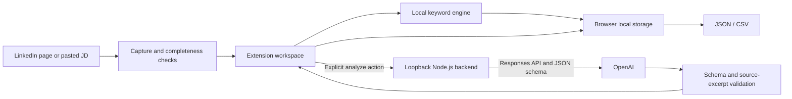

# Job Scout

**A Chrome/Edge extension for collecting job descriptions, tracking applications, and matching resume variants with inspectable evidence.**

[中文说明](README.zh-CN.md) · [API setup](docs/setup.md) · [Architecture](docs/architecture.md) · [Contributing](CONTRIBUTING.md)

Job searches produce a lot of tabs and repeated decisions: Is this role relevant? Which resume should I use? Which requirements are actually supported by my experience? Job Scout brings those steps into one local workflow, with optional OpenAI analysis using each user's own API account.

> **Status: v0.6 prototype.** Rule matching, mocked capture/API tests, and a local browser smoke test have passed. Live OpenAI calls and live LinkedIn extraction still require verification. The UI and AI explanations are currently in Chinese. Rule mode ships with generic example role vocabularies; API mode accepts your own resume text and preferences.

## What it does

- **Capture jobs:** read the selected LinkedIn job or process related titles from already-loaded result cards; paste a JD when extraction is unavailable.
- **Check capture consistency:** compare selected job IDs and stable description text to reduce accidental pairing with a neighboring job.
- **Route resumes:** suggest DS, DA, or Research variants with keyword evidence in rule mode.
- **Analyze with OpenAI:** distinguish required/preferred/unclear criteria, quote JD and resume evidence, recommend a supplied resume, and identify questions to verify.
- **Track locally:** retain application status when refreshing a job; export JSON or CSV with links, analysis and recommendations.
- **Control API use:** paid analysis runs for one job only after an explicit click. No automatic retries or paid batch analysis.

This is an application-review assistant. It does not submit applications, rewrite resumes, predict hiring outcomes, or autonomously crawl LinkedIn.

## Two modes

| | Rule mode | OpenAI API mode |
|---|---|---|
| Backend | None | Local Node.js server |
| Credentials | None | Your OpenAI API key in a local `.env` file |
| Resume basis | Generic example vocabulary | Your supplied DS / DA / Research text |
| Output | Keyword coverage and routing | Structured requirements, source excerpts and reasoning |
| External transmission | No model request | Current job, supplied resumes and preferences sent to OpenAI |
| Cost | No model cost | Billed to your API account |

The rule percentage is a heuristic keyword indicator, **not a calibrated fit score**. AI output is separate and does not replace record ordering with a generated percentage.

## Install and try rule mode

1. Download this repository and extract it, or clone it.
2. Open `chrome://extensions` or `edge://extensions` and enable **Developer mode**.
3. Choose **Load unpacked** and select the folder containing `manifest.json`.
4. Open a LinkedIn Jobs detail page, click the extension and select **读取并保存当前职位**.
5. Alternatively, enter a title, paste a complete JD, confirm completeness, and select **分析 JD / 调整搜索关键词** followed by **保存职位**.

For the batch workflow, open LinkedIn search results and click **扫描 Title → JD → 匹配**. Keep the new workspace and original LinkedIn tab open. Only loaded cards are processed; scroll and scan again for more. Searches default to US jobs posted within 48 hours, newest first. Verify posting dates yourself when pasting or opening jobs manually.

## Enable API mode

Requires **Node.js 22+**, an OpenAI API account and an accessible model supporting Responses with strict Structured Outputs. There are no npm runtime dependencies.

1. Copy `.env.example` to `.env`.
2. Set `OPENAI_API_KEY` and `OPENAI_MODEL` locally.
3. Generate a connection token and set it as `JOB_SCOUT_TOKEN`:

   ```sh
   node -e "console.log(require('node:crypto').randomBytes(32).toString('hex'))"
   ```

4. Start the local backend:

   ```sh
   npm start
   ```

5. In **OpenAI API 模式**, enter the **connection token**, not your OpenAI key. Paste at least one resume and enter your preferences.
6. Check the local connection, load a complete job, review the transmission notice, and click **用 OpenAI 分析当前职位**.

Keep the page open until completion. Results appear in the saved job record. See [setup and troubleshooting](docs/setup.md) for full details. Health checks do not call OpenAI or validate credentials.

## Architecture



The server binds to `127.0.0.1:43127`. API keys stay in the server environment; browser-to-server requests use a separate bearer token. Source excerpts are checked against submitted text before a model result is accepted. This verifies quotation provenance, not the semantic correctness of the model's conclusion.

## Verification

```sh
npm test
```

The suite covers keyword routing, salary parsing, complete/partial record ordering, stale-JD rejection, API request contracts, authentication/origin checks, evidence validation, refusal, incomplete output, timeout and concurrency behavior. Tests use synthetic data and mocked model responses; no paid API calls are made. GitHub Actions is configured to run these checks on Node.js 22 on Linux and Windows.

## Limitations and privacy

- LinkedIn selectors can change; capture checks are heuristics. Use the paste fallback and review the result.
- Rule mode does not parse every required/preferred qualification and uses a generic example preset. It must not be read as an assessment of every user's abilities.
- API mode stores user-provided profiles locally, not encrypted. Omit contact details if unnecessary. API requests use `store: false`, which is not a guarantee of zero provider retention.
- Exports can contain JD text and resume excerpts. Do not commit them or personal resumes to a public repository.
- A changed title or JD marks existing AI results stale. Changing a resume requires a fresh analysis.
- A failed or timed-out API request may still incur provider charges. No automatic retry is performed.
- No real-world matching-quality benchmark or hiring-impact measurement has been completed.

## Project layout

```text
manifest.json          Chrome/Edge Manifest V3 configuration
popup.html / popup.js  Capture, records and export UI
capture.js             LinkedIn detail extraction
engine.js              Deterministic matching and resume routing
api-ui.js              Optional API workflow and result rendering
server.cjs             Local authenticated OpenAI proxy
api-contract.cjs       Structured output schema and evidence instructions
*.test.cjs / test.cjs  Automated checks
.env.example           Blank configuration template
```

## Next steps

- Verify live OpenAI and LinkedIn flows with documented results.
- Make rule-mode profile presets configurable.
- Add an English UI and a reproducible browser integration test.
- Add a manual ChatGPT handoff and result-import workflow.

## License

MIT. See [LICENSE](LICENSE). This project is not affiliated with LinkedIn or OpenAI.
